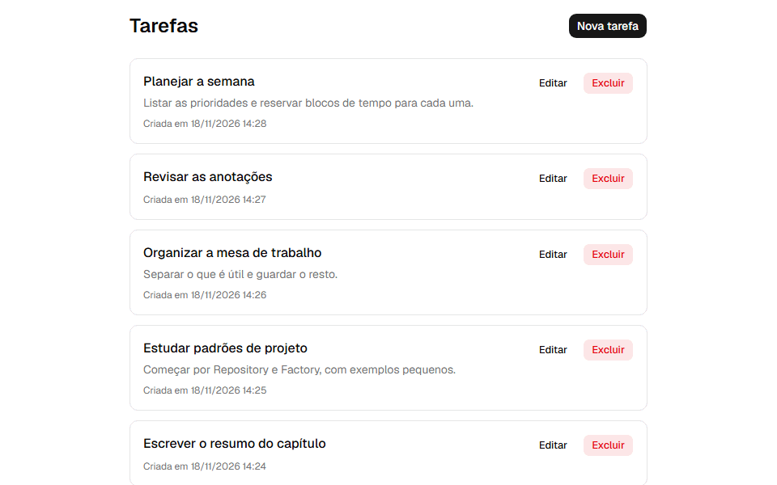
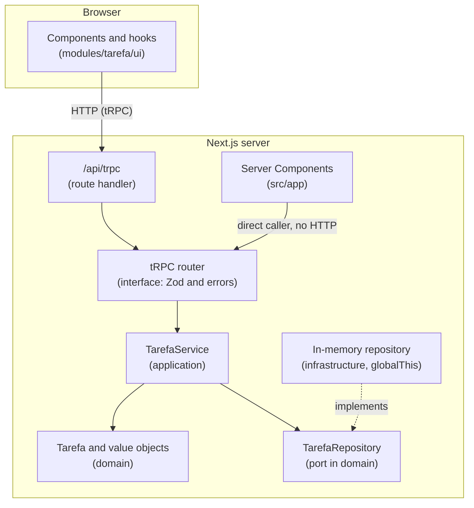

# Task Manager

[Português](README.md) | **English**

A Next.js application to list, create, edit and delete tasks. The backend keeps the list in memory (no database) and is exposed through tRPC, inside the same application. All data is fictitious.



<details>
<summary>Task list screenshot</summary>


</details>

> The app's UI and messages are in Brazilian Portuguese, as are the identifiers of the domain (`Tarefa` = task, `titulo` = title, `descricao` = description, `dataCriacao` = creation date).

## Challenge requirements

- **CRUD via tRPC** (`criar`, `listar`, `buscarPorId`, `atualizar`, `deletar`): `src/modules/tarefa/interface/tarefa-router.ts`.
- **Validation** (no task without a title): `src/modules/tarefa/interface/schema.ts` and `src/modules/tarefa/domain/regras.ts`.
- **Meaningful errors** (e.g. updating a task that does not exist): `src/modules/tarefa/interface/mapear-erro-de-dominio.ts` and `src/server/trpc.ts`.
- **List page with SSR** (list preloaded on the server): `src/app/tarefas/page.tsx`.
- **Delete with feedback** on success and error: `src/modules/tarefa/ui/hooks/use-excluir-tarefa.ts` and `src/modules/tarefa/ui/components/excluir-tarefa-dialog.tsx`.
- **Create and edit form** built with hooks and validation: `src/modules/tarefa/ui/components/tarefa-form.tsx` (react-hook-form + `zodResolver`).
- **Loading, success and error states**: `src/modules/tarefa/ui/components/lista-carregando.tsx`, `erro-ao-carregar.tsx` and `lista-vazia.tsx`, plus the notifications in the save and delete hooks.
- **Bonus: infinite scroll**: `src/modules/tarefa/ui/components/carregar-mais.tsx` and `src/modules/tarefa/ui/hooks/use-tarefas.ts`.
- **Bonus: documentation**: this README and comments on the decisions in the code.

Project board (planning as Epic, Story and Task): [GitHub Project](https://github.com/users/carlosbandelli/projects/5).

Stack: Next.js 16 (App Router), React 19, tRPC 11 with TanStack Query 5, Zod 4, react-hook-form, Tailwind CSS 4 and shadcn/ui components.

## Running it

Requirement: Node.js 24 (version in `.nvmrc`). The minimum version declared in `engines` is 20.9.0.

```bash
npm install
npm run dev
```

Open `http://localhost:3000`. The root redirects to `/tarefas`.

Data lives in memory, inside the server process. On startup the list has 25 fictitious tasks. Restarting the server restores that list.

To try the production build:

```bash
npm run build
npm run start
```

## Scripts

- `npm run dev`: development server at `http://localhost:3000`.
- `npm run build`: production build. It downloads the Geist fonts from Google, so it needs network access.
- `npm run start`: serves the production build.
- `npm test`: unit, component and architecture tests (Vitest).
- `npm run test:e2e`: end-to-end tests with Playwright. **Optional.** Run `npx playwright install chromium` once before.
- `npm run lint`: ESLint, including the architecture boundaries.
- `npm run typecheck`: `next typegen` and `tsc --noEmit`.
- `npm run format`: formats the project with Prettier.
- `npm run format:check`: checks formatting with Prettier without changing files.

## How it works



On the list page, the server awaits the prefetch of the first page by calling the router directly, without HTTP. The HTML ships with the tasks, and the cache is sent to the browser serialized with superjson. The client hydrates that cache and does not fetch again right away (`staleTime` of 30 seconds).

Interactive diagrams (open in the browser):

- [Architecture: modular monolith](docs/diagramas/arquitetura.html)
- [Sequence: SSR, hydration and infinite scroll of `/tarefas`](docs/diagramas/sequencia-ssr-tarefas.html)

### API (`tarefa.*`)

- `tarefa.criar` (mutation): input `{ titulo, descricao? }`; output: task; errors: `BAD_REQUEST`.
- `tarefa.listar` (query): input `{ cursor?, limit? }` (`limit` defaults to 10, from 1 to 50); output: `{ itens, proximoCursor }`; errors: `BAD_REQUEST` (invalid cursor).
- `tarefa.buscarPorId` (query): input `{ id }`; output: task; errors: `NOT_FOUND`, `BAD_REQUEST` (malformed id).
- `tarefa.atualizar` (mutation): input `{ id, titulo?, descricao? }`; output: task; errors: `NOT_FOUND`, `BAD_REQUEST`.
- `tarefa.deletar` (mutation): input `{ id }`; output: `{ id }`; errors: `NOT_FOUND`, `BAD_REQUEST` (malformed id).

- Task: `id` (UUID generated by the server), `titulo` (1 to 120 characters, trimmed), `descricao` (optional, up to 1000 characters), `dataCriacao` and `dataAtualizacao` (optional).
- `criar` ignores any `id` and `dataCriacao` sent by the client.
- `atualizar` handles `descricao` in three ways: a missing field keeps the current value; `null` or an empty string clears it; new text replaces it. The `id` never changes, and a `dataCriacao` sent by the client is ignored.
- `listar` sorts from newest to oldest. Pagination uses an opaque cursor.
- Validation errors return `BAD_REQUEST` with `data.zodError` (errors per field) and the first message in Portuguese. Business rule errors return `BAD_REQUEST` with `data.campo`. A missing task returns `NOT_FOUND` with the message "Tarefa não encontrada" (task not found). Any unexpected error returns `INTERNAL_SERVER_ERROR` with a generic message, without a stack trace.

## Architecture and decisions

- **Modular monolith.** The whole task domain lives in `src/modules/tarefa`, with the layers `domain`, `application`, `infrastructure`, `interface` and `ui`. Outside the module only its public API can be imported: `index.ts` (server) and `ui/index.ts` (client). ESLint (`import/no-restricted-paths`) enforces these boundaries, and the `arquitetura.test.ts` test runs ESLint against allowed and forbidden imports. A new module is added as a sibling folder, without touching the existing one.
- **Tactical DDD.** `Tarefa` is the entity (aggregate root): private constructor, `criar` and `reconstituir` factories, and the `atualizar` method, which keeps the invariants. `Titulo`, `Descricao` and `TarefaId` are immutable value objects compared by value. `TarefaRepository` is a port defined in the domain. `TarefaService` orchestrates the use cases. `TarefaDTO` is what leaves the application layer, so the entity never does.
- **SOLID, with examples from the code:**
  - Single responsibility: `Tarefa` holds the rules, `TarefaService` orchestrates, the repository stores data, `TarefaItem` only renders and the `useTarefas` hook only fetches data.
  - Open/closed: a new storage is a new class that implements `TarefaRepository`.
  - Liskov substitution: the contract suite in `domain/testing/tarefa-repository.contract.ts` runs against the in-memory repository and against the fake used in the service tests.
  - Interface segregation: small, separate ports (`TarefaRepository`, `Relogio`, `GeradorDeId`).
  - Dependency inversion: `TarefaService` receives the ports in its constructor, `container.ts` injects the implementations, and the router receives the service through the tRPC context.
- **Validation in two layers.** Zod validates at the edge and returns per-field messages to the form. The value objects validate in the domain, so the invariants hold even without going through the edge. The limits come from `domain/regras.ts`, and a test checks that Zod and the domain measure text length the same way.
- **tRPC inside the same app.** The router lives in a route handler (`/api/trpc`). Server Components call the same router directly, without HTTP. There is no separate server: the challenge asks for a single application, and this way types flow from server to client.
- **In-memory storage in `globalThis`.** The repository lives in `globalThis`, under a `Symbol.for`, because Next's HMR re-evaluates modules. With a module-level variable, tasks would vanish on every edit in development. The service, clock and id generator are recreated on each module evaluation, so no stale code remains after HMR.
- **`Date` with superjson.** `dataCriacao` is a `Date` on the server and on the client. superjson preserves the type during serialization, so the app does not convert dates on every render.
- **Keyset pagination with a cursor.** The cursor encodes the `dataCriacao` and `id` of the last item, not a position in the list. So creating or deleting tasks between two pages neither repeats nor skips items.
- **Manual memoization.** The React Compiler is turned off on purpose (`next.config.ts`), so memoization is explicit and demonstrable. `TarefaItem` uses `React.memo` with a custom comparator (`tarefaItemPropsIguais`): after a refetch superjson recreates the `Date` objects, so a shallow reference comparison would not be enough. The delete handler uses `useCallback`, and the flattened list of pages uses `useMemo`. A test counts renders and proves that deleting a task does not re-render the others, even after the refetch.
- **SSR with an awaited prefetch.** The page `await`s the prefetch. Without the `await`, the HTML would ship only the loading skeleton. The list and edit pages render on every request (`force-dynamic`), because the data changes in memory.
- **Errors without leaking internals.** Domain errors are translated to `NOT_FOUND` or `BAD_REQUEST` by a single mapper (`mapearErroDeDominio`). Any other error becomes `INTERNAL_SERVER_ERROR` with a generic message. The client cache also hides unexpected errors.
- **Next.js 16 instead of v15.** The challenge mentions v15, but the project uses the latest stable Next.js.
- **Dates in a fixed time zone.** Dates are formatted in the `America/Sao_Paulo` time zone, so the server HTML and the browser HTML are identical.

## Limitations and next steps

- Data lives in the server process. It is not shared between replicas and does not survive a restart. In serverless environments each instance would have its own list.
- The path to production is a new implementation of `TarefaRepository`, for example on top of Redis. It must pass the contract suite. Since the port is asynchronous, real I/O fits without changing the service or the UI. Only the repository created in `container.ts` needs to change.

## Tests

- **Domain** (`src/modules/tarefa/domain/*.test.ts`): value objects, entity, errors, rules and validation parity with Zod.
- **Repository contract** (`domain/testing/tarefa-repository.contract.ts`): the same suite runs against the in-memory repository and against the service fake.
- **Service and repository** (`application/*.test.ts`, `infrastructure/*.test.ts`): use cases, ordering, cursor pagination and `NOT_FOUND`.
- **Router and integration** (`src/server/routers/_app.test.ts`, `src/server/trpc.test.ts`, `src/modules/tarefa/interface/*.test.ts`): validation, error codes and messages, through the caller and over HTTP.
- **Architecture** (`src/modules/tarefa/arquitetura.test.ts`): the ESLint boundaries.
- **Components and hooks** (`src/modules/tarefa/ui/**/*.test.tsx`, with jsdom and Testing Library): form, delete flow, list states, infinite scroll and the memoization proof (`tarefa-item.memo.test.tsx`).
- **SSR** (`src/app/tarefas/ssr-primeira-renderizacao.test.tsx`, `src/app/tarefas/[id]/editar/page.test.tsx`).
- **E2E** (`e2e/jornada.spec.ts`, optional): list HTML already with items and without JavaScript, the create, edit, delete and scroll journey, and the edit page 404. Playwright starts its own server, with a production build on port 3200. It is not part of `npm test`.

To run them: `npm test` runs the Vitest tests. For E2E, run `npx playwright install chromium` once and then `npm run test:e2e`.

## Folder structure

```
src/
  app/                 routes (thin Server Components) and /api/trpc
  modules/tarefa/      task module
    domain/            entity, value objects, errors and ports
    application/       TarefaService and DTOs
    infrastructure/    in-memory repository, clock, id generator and seed
    interface/         Zod schemas, tRPC router and error mapping
    ui/                components, hooks and the client public API
  server/              tRPC init, context, errorFormatter and routers
  trpc/                tRPC client, QueryClient and SSR helpers
  components/ui/       shadcn/ui primitives
  lib/                 utilities
e2e/                   E2E tests with Playwright
```
