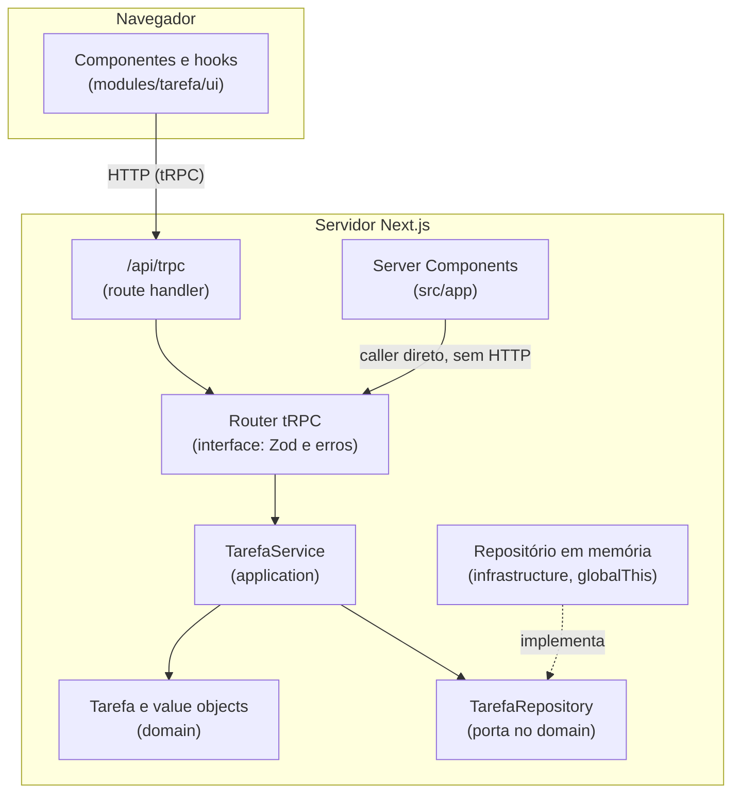

# Gerenciador de Tarefas

Aplicação Next.js para listar, criar, editar e excluir tarefas. O backend mantém a lista em memória (sem banco de dados) e é exposto via tRPC, na mesma aplicação. Todos os dados são fictícios.

## Requisitos do enunciado

- **CRUD via tRPC** (`criar`, `listar`, `buscarPorId`, `atualizar`, `deletar`): `src/modules/tarefa/interface/tarefa-router.ts`.
- **Validação** (não cria tarefa sem título): `src/modules/tarefa/interface/schema.ts` e `src/modules/tarefa/domain/regras.ts`.
- **Erros significativos** (ex.: atualizar tarefa inexistente): `src/modules/tarefa/interface/mapear-erro-de-dominio.ts` e `src/server/trpc.ts`.
- **Listagem com SSR** (lista pré-carregada): `src/app/tarefas/page.tsx`.
- **Exclusão com feedback** de sucesso e erro: `src/modules/tarefa/ui/hooks/use-excluir-tarefa.ts` e `src/modules/tarefa/ui/components/excluir-tarefa-dialog.tsx`.
- **Formulário** de criação e edição com hooks e validação: `src/modules/tarefa/ui/components/tarefa-form.tsx` (react-hook-form + `zodResolver`).
- **Estados** de carregamento, sucesso e erro: `src/modules/tarefa/ui/components/lista-carregando.tsx`, `erro-ao-carregar.tsx` e `lista-vazia.tsx`, além das notificações nos hooks de salvar e excluir.
- **Bônus: infinite scroll**: `src/modules/tarefa/ui/components/carregar-mais.tsx` e `src/modules/tarefa/ui/hooks/use-tarefas.ts`.
- **Bônus: documentação**: este README e comentários nas decisões do código.

Stack: Next.js 16 (App Router), React 19, tRPC 11 com TanStack Query 5, Zod 4, react-hook-form, Tailwind CSS 4 e componentes shadcn/ui.

## Como rodar

Pré-requisito: Node.js 24 (versão do `.nvmrc`). A versão mínima declarada em `engines` é 20.9.0.

```bash
npm install
npm run dev
```

Abra `http://localhost:3000`. A raiz redireciona para `/tarefas`.

Os dados ficam em memória, no processo do servidor. Ao iniciar, a lista tem 25 tarefas fictícias. Reiniciar o servidor restaura essa lista.

Para testar o build de produção:

```bash
npm run build
npm run start
```

## Scripts

- `npm run dev`: servidor de desenvolvimento em `http://localhost:3000`.
- `npm run build`: build de produção. Baixa as fontes Geist do Google, então precisa de rede.
- `npm run start`: sobe o build de produção.
- `npm test`: testes unitários, de componentes e de arquitetura (Vitest).
- `npm run test:e2e`: testes E2E com Playwright. **Opcional.** Antes, rode `npx playwright install chromium` (uma vez).
- `npm run lint`: ESLint, incluindo as fronteiras de arquitetura.
- `npm run typecheck`: `next typegen` e `tsc --noEmit`.
- `npm run format`: formata o projeto com Prettier.
- `npm run format:check`: verifica a formatação com Prettier, sem alterar arquivos.

## Como funciona



Na listagem, a página aguarda o prefetch da primeira página chamando o router diretamente, sem HTTP. O HTML sai com as tarefas, e o cache vai ao navegador serializado com superjson. O cliente hidrata esse cache e não refaz a busca logo em seguida (`staleTime` de 30 segundos).

Diagramas interativos (abra no navegador):

- [Arquitetura: monólito modular](docs/diagramas/arquitetura.html)
- [Sequência: SSR, hidratação e infinite scroll de `/tarefas`](docs/diagramas/sequencia-ssr-tarefas.html)

### API (`tarefa.*`)

- `tarefa.criar` (mutation): entrada `{ titulo, descricao? }`; saída: tarefa; erros: `BAD_REQUEST`.
- `tarefa.listar` (query): entrada `{ cursor?, limit? }` (`limit` padrão 10, de 1 a 50); saída: `{ itens, proximoCursor }`; erros: `BAD_REQUEST` (cursor inválido).
- `tarefa.buscarPorId` (query): entrada `{ id }`; saída: tarefa; erros: `NOT_FOUND`, `BAD_REQUEST` (id malformado).
- `tarefa.atualizar` (mutation): entrada `{ id, titulo?, descricao? }`; saída: tarefa; erros: `NOT_FOUND`, `BAD_REQUEST`.
- `tarefa.deletar` (mutation): entrada `{ id }`; saída: `{ id }`; erros: `NOT_FOUND`, `BAD_REQUEST` (id malformado).

- Tarefa: `id` (UUID gerado pelo servidor), `titulo` (1 a 120 caracteres, sem espaços nas pontas), `descricao` (opcional, até 1000 caracteres), `dataCriacao` e `dataAtualizacao` (opcional).
- `criar` ignora `id` e `dataCriacao` enviados pelo cliente.
- `atualizar` trata `descricao` em três casos: campo ausente mantém o valor atual; `null` ou string vazia apaga a descrição; texto novo substitui a anterior. O `id` não muda, e `dataCriacao` enviado pelo cliente é ignorado.
- `listar` ordena da tarefa mais recente para a mais antiga. A paginação é por cursor opaco.
- Erros de validação retornam `BAD_REQUEST` com `data.zodError` (erros por campo) e a primeira mensagem em pt-BR. Erros de regra de negócio retornam `BAD_REQUEST` com `data.campo`. Tarefa inexistente retorna `NOT_FOUND` com a mensagem "Tarefa não encontrada". Qualquer erro inesperado retorna `INTERNAL_SERVER_ERROR` com a mensagem "Erro interno. Tente novamente.", sem stack.

## Arquitetura e decisões

- **Monólito modular.** Todo o domínio de tarefas fica em `src/modules/tarefa`, com as camadas `domain`, `application`, `infrastructure`, `interface` e `ui`. Fora do módulo, só se importa a API pública: `index.ts` (servidor) e `ui/index.ts` (cliente). O ESLint (`import/no-restricted-paths`) impõe essas fronteiras, e o teste `arquitetura.test.ts` roda o ESLint sobre imports permitidos e proibidos. Um novo módulo entra como pasta irmã, sem alterar o existente.
- **DDD tático.** `Tarefa` é a entidade (aggregate root): construtor privado, fábricas `criar` e `reconstituir`, e o método `atualizar`, que mantém as invariantes. `Titulo`, `Descricao` e `TarefaId` são value objects imutáveis, comparados por valor. `TarefaRepository` é uma porta definida no domínio. `TarefaService` orquestra os casos de uso. `TarefaDTO` é o que sai da aplicação, então a entidade nunca sai dela.
- **SOLID, com exemplos do código:**
  - Responsabilidade única: `Tarefa` guarda as regras, `TarefaService` orquestra, o repositório guarda os dados, `TarefaItem` só exibe e o hook `useTarefas` só busca dados.
  - Aberto/fechado: um novo armazenamento é uma nova classe que implementa `TarefaRepository`.
  - Substituição de Liskov: a suíte de contrato em `domain/testing/tarefa-repository.contract.ts` roda contra o repositório em memória e contra o fake usado nos testes do service.
  - Segregação de interfaces: portas pequenas e separadas (`TarefaRepository`, `Relogio`, `GeradorDeId`).
  - Inversão de dependência: `TarefaService` recebe as portas no construtor, `container.ts` injeta as implementações, e o router recebe o service pelo contexto do tRPC.
- **Validação em duas camadas.** O Zod valida na borda e devolve mensagens por campo para o formulário. Os value objects validam no domínio, então as invariantes valem mesmo sem passar pela borda. Os limites vêm de `domain/regras.ts`, e um teste confere que o Zod e o domínio contam o tamanho do texto da mesma forma.
- **tRPC na mesma aplicação.** O router fica em um route handler (`/api/trpc`). Os Server Components chamam o mesmo router diretamente, sem HTTP. Não há servidor separado: o enunciado pede uma aplicação só, e assim os tipos fluem do servidor até o cliente.
- **Memória em `globalThis`.** O repositório fica em `globalThis`, sob um `Symbol.for`, porque o HMR do Next reavalia módulos. Com uma variável de módulo, as tarefas sumiriam a cada edição em desenvolvimento. Service, relógio e gerador de ids são recriados a cada avaliação do módulo, para não sobrar código antigo depois do HMR.
- **`Date` com superjson.** `dataCriacao` é um `Date` no servidor e no cliente. O superjson preserva o tipo na serialização, então a aplicação não converte datas em cada exibição.
- **Paginação keyset por cursor.** O cursor codifica `dataCriacao` e `id` do último item, não uma posição na lista. Por isso, criar ou excluir tarefas entre duas páginas não repete nem pula itens.
- **Memoização manual.** O React Compiler está desligado de propósito (`next.config.ts`), para que a memoização seja explícita e demonstrável. `TarefaItem` usa `React.memo` com um comparador próprio (`tarefaItemPropsIguais`): após um refetch, o superjson recria os objetos `Date`, então uma comparação rasa por referência não bastaria. O handler de exclusão usa `useCallback`, e a lista achatada das páginas usa `useMemo`. Um teste conta as renderizações e comprova que excluir uma tarefa não re-renderiza as outras, inclusive depois do refetch.
- **SSR com prefetch aguardado.** A página faz `await` do prefetch. Sem o `await`, o HTML sairia só com o esqueleto de carregamento. As páginas de listagem e de edição são renderizadas a cada requisição (`force-dynamic`), porque os dados mudam em memória.
- **Erros sem vazar detalhe interno.** Erros de domínio são traduzidos para `NOT_FOUND` ou `BAD_REQUEST` por um único mapeador (`mapearErroDeDominio`). Qualquer outro erro vira `INTERNAL_SERVER_ERROR` com mensagem genérica. O cache do cliente também oculta erros inesperados.
- **Next.js 16 em vez da v15.** O enunciado cita a v15, mas o projeto usa a versão estável mais recente do Next.js.
- **Datas com fuso fixo.** As datas são formatadas no fuso `America/Sao_Paulo`, para que o HTML do servidor e o do navegador sejam idênticos.

## Limitações e evolução

- Os dados ficam no processo do servidor. Eles não são compartilhados entre réplicas e não sobrevivem a um reinício. Em ambientes serverless, cada instância teria a própria lista.
- O caminho para produção é uma nova implementação de `TarefaRepository`, por exemplo sobre Redis. Ela deve passar na suíte de contrato. Como a porta é assíncrona, o I/O cabe nela sem mudar o service nem a UI. Basta trocar o repositório criado em `container.ts`.

## Testes

- **Domínio** (`src/modules/tarefa/domain/*.test.ts`): value objects, entidade, erros, regras e paridade de validação com o Zod.
- **Contrato do repositório** (`domain/testing/tarefa-repository.contract.ts`): a mesma suíte roda contra o repositório em memória e contra o fake do service.
- **Service e repositório** (`application/*.test.ts`, `infrastructure/*.test.ts`): casos de uso, ordem, paginação por cursor e `NOT_FOUND`.
- **Router e integração** (`src/server/routers/_app.test.ts`, `src/server/trpc.test.ts`, `src/modules/tarefa/interface/*.test.ts`): validação, códigos de erro e mensagens, pelo caller e pelo HTTP.
- **Arquitetura** (`src/modules/tarefa/arquitetura.test.ts`): as fronteiras do ESLint.
- **Componentes e hooks** (`src/modules/tarefa/ui/**/*.test.tsx`, com jsdom e Testing Library): formulário, exclusão, estados da lista, infinite scroll e a prova de memoização (`tarefa-item.memo.test.tsx`).
- **SSR** (`src/app/tarefas/ssr-primeira-renderizacao.test.tsx`, `src/app/tarefas/[id]/editar/page.test.tsx`).
- **E2E** (`e2e/jornada.spec.ts`, opcional): HTML da listagem já com itens e sem JavaScript, jornada de criar, editar, excluir e rolar a lista, e a página 404 da edição. O Playwright sobe o próprio servidor, com build de produção na porta 3200. Não entra em `npm test`.

Para rodar: `npm test` executa os testes do Vitest. Para o E2E, rode `npx playwright install chromium` uma vez e depois `npm run test:e2e`.

## Estrutura de pastas

```
src/
  app/                 rotas (Server Components finos) e /api/trpc
  modules/tarefa/      módulo de tarefas
    domain/            entidade, value objects, erros e portas
    application/       TarefaService e DTOs
    infrastructure/    repositório em memória, relógio, gerador de ids e seed
    interface/         schemas Zod, router tRPC e mapeamento de erros
    ui/                componentes, hooks e API pública do cliente
  server/              init do tRPC, contexto, errorFormatter e routers
  trpc/                cliente tRPC, QueryClient e helpers de SSR
  components/ui/       primitivos do shadcn/ui
  lib/                 utilitários
e2e/                   testes E2E com Playwright
```
